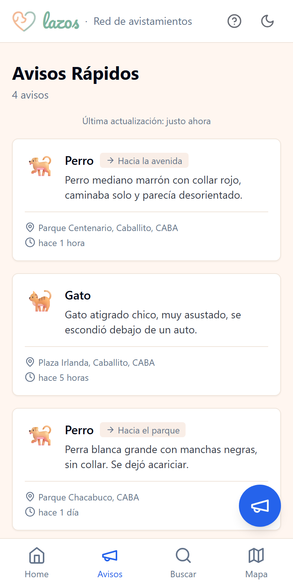
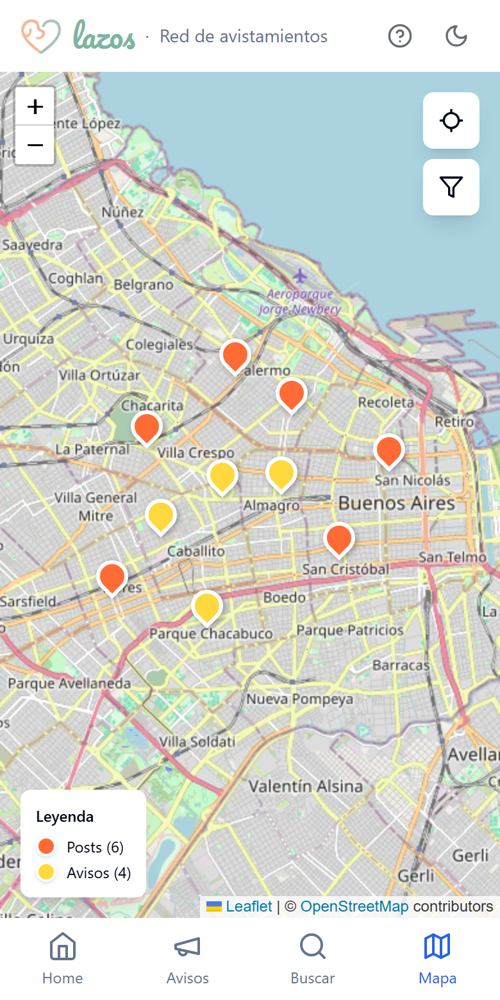

# Lazos

**Red colaborativa para reportar mascotas vistas en la calle.** Publicás el animal que viste y dónde, y aparece en
el mapa para que su familia lo encuentre. Sin registro ni publicidad.

> **Proyecto en construcción.** Todavía no está publicado.

## Cómo

1. Ves un perro o un gato suelto: sacás una foto o, si se mueve rápido, cargás un aviso sin foto.
2. Marcás dónde lo viste y publicás. Fotos y textos pasan por una moderación automática.
3. Quien busca a su mascota la encuentra en el mapa o en el buscador, con filtros por zona y tipo de animal.

Cómo levantarlo y detalles técnicos en [docs/desarrollo.md](docs/desarrollo.md). Licencia [CC BY-NC-SA 4.0](LICENSE).
